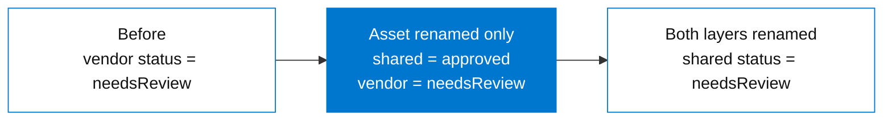

# Namespace and Prefix Isolation for USD Extensions

**Author:** Aaron Luk (NVIDIA)

**Status:** Draft

## Summary

This proposal defines naming requirements for independently governed USD
extensions. One reservation covers an extension's naming scope, with rules
mapping it to schema identifiers, property names, and other covered names.
Owners can organize and delegate their scopes without seeking approval for
every identifier.

The rules must prevent independent definitions from colliding and support
ownership and naming transitions. They must work across USD implementations.
Concrete naming conventions and validation deployment remain open; transition
guidance and prototype tooling are proposed deliverables.

This develops the Namespace and Prefix Isolation requirement in the
[Steering Committee's USD Extension Ecosystem Governance working proposal](https://docs.google.com/document/d/1zL7Igy5QN6bTHZavczkjaW2U5TBk95hP_Ooa_zL-tJc/edit),
led by Sean Snyders. Naming allocation does not approve extension semantics,
establish implementation support, or guarantee behavioral compatibility.

## Motivation

USD extensions are already being developed and deployed across domains.
Independent definitions can acquire the same identifiers, causing registration
errors or use of the wrong definition. Domain extensions need to develop
independently of core OpenUSD's release cadence while keeping their names
distinct in exchanged content.

A library prefix does not necessarily qualify a scene-facing schema name.
A typed schema name likewise does not qualify separately named APIs.
Properties may be authored in layers with no local type declaration.
Naming rules must address these lookup contexts together.

Naming isolation must also work before a complete discovery or distribution
service exists. A catalog can help people find extensions, but listing one
does not itself allocate its names or prevent collisions.

## Scope

The initial naming contract covers typed schema identifiers, applied API schema
identifiers, and property names. It must relate these scopes to metadata keys
and capability/profile identifiers. File-format and asset-resolver identifiers
remain subjects for subsequent work.

The contract addresses allocation, hierarchy and delegation, naming rules,
identifier transitions, and any naming checks adopted after discussion.
Consumer fallback, dependency resolution, semantic compatibility, support
claims, deployment, certification, and standardization belong to the broader
extension-governance work. Semantic data conversion and general schema
versioning are also outside this proposal.

## Terminology

- **Owner:** A vendor, community project, collaboration, or standards body
  authorized to govern a naming scope. This is naming authority, distinct from
  intellectual-property ownership of an asset or implementation.
- **Extension:** A related set of definitions governed by an owner. It is the
  unit whose naming scope is reserved, regardless of packaging or loading.
- **Reservation:** An allocation recording an extension, its owner, and its
  permitted naming scope. Its record identifier need not be a schema name.
- **Prefix:** Leading tokens identifying ownership or scope in a name.
- **Namespace:** Names scoped by a prefix or equivalent qualification.
- **Naming surface:** Identifiers sharing syntax and a lookup context, such as
  typed schema identifiers or property names.

Ownership, maturity, version, and implementation support are separate facts.
`Prelim` describes maturity, not ownership. Implementing an existing definition
does not create a new naming authority for it.

## Functional Requirements

R3 is incorporated into R2; the other labels are retained for review continuity.

### R1. Consistent Prefixes

Ownership prefixes must be consistent for names governed by the same owner.

### R2. Hierarchy and Delegation

Owners can organize their naming hierarchy and delegate parts of it however
they choose.

### R4. One Reservation Across Surfaces

One reservation must cover an extension's names across all naming surfaces.
The naming rules must prevent collisions on every surface.

### R5. Naming Allocations

Record who controls each naming scope, and allocate scopes so independent
owners' names remain distinct.

### R6. Ownership and Naming Transitions

Support ownership and naming transitions, especially promotion toward shared
ownership or standardization. Define how existing names and content are handled.

### R7. Lightweight Administration

Reserving and maintaining a naming scope must require minimal process.

### R8. Implementation Independence

The naming rules, and any validation checks defined, must work in any USD
implementation.

### R9. Validation Scope and Cost

When validation is performed, it must say what it checked and couldn't determine,
without excessive runtime cost.

## Naming Contract

### Allocation and Authority

The reservation record must identify the owner, allocated scope, and any
delegation or transition. An owner may govern several extensions; their scopes
must distinguish independent definitions under that owner. A collaboration may
be the owner from the outset. Delegated authority must be recorded; an owner's
organizational hierarchy need not mirror its domains or features.

The reservation identifier names the allocation record. Separate rules map that
allocation to names on each surface; the identifier need not appear verbatim
in any schema name. The record format and allocation procedure remain open.

An ownership prefix must be traceable to its allocation. A product name or
trademark alone is not an allocation. Reservation can precede a complete
specification, implementation, or commitment to publish. Conforming names
within the scope need no individual approval. Administrative review concerns
the allocation; review of feature semantics belongs to broader governance.

#### Registry upkeep

Keep owner, contact, and entry status current through a lightweight process.
Record the authority for updates and when they were made, including what is
known when an owner becomes unreachable or an extension is no longer maintained.

Review cadence, expiry, renewal deadlines, and name reuse remain open.
An inactive status does not itself authorize reassignment or invalidate existing
content. Extension maturity and registry status are separate: `Prelim` does not
automatically mean a temporary reservation. The
[maintenance precedents](#registry-maintenance-precedents) illustrate these
distinctions.

### Names Across Surfaces

Each covered identifier must have an unambiguous relationship to its reservation.
Spelling may differ by surface. Distinguish internal implementation names from
names authored into content, and API instance names from API definition names.

Owner and domain hierarchies are independent. These are logical components,
not allocated reservation identifiers or prescribed schema spellings:

| Owner components | Domain or feature components |
|---|---|
| `AOUSD`, `GeomWG` | `brep` |
| `yoyodyne`, `tierA` | `dimensional`, `contabulator` |
| `yoyodyne` | `dimensional`, `contabulator` |

An owner's intermediate levels can represent working groups, divisions, or
another structure. `yoyodyne` is the placeholder used in the Profiles proposal.
Owner-first naming is a candidate; token order and casing remain open.
Reusing another owner's definition retains its existing identity.

#### Candidate mappings from reservations to names

The [standards survey](#precedents-and-alternatives) informs two possible
mappings. Neither is selected.

Consider a fictional record `ext-0042`, owned by `Yoyodyne`, with domain/feature
components `geom`, `brep`. The opaque key is illustrative; a registry could
instead use a readable extension name or another identifier format.

- **A. Declared surface prefixes:** one reservation records a compact schema
  prefix (`YoyodyneBrep`) and property prefix (`yoyodyne:brep`).
- **B. Component-preserving encoding:** shared rules encode recorded components
  using underscores in schema names and colons in property names.

| Surface | A. Declared prefixes | B. Component encoding |
|---|---|---|
| Reservation identifier | `ext-0042` | `ext-0042` |
| Concrete schema | `YoyodyneBrepArray` | `Yoyodyne_geom_brep_Array` |
| API schema | `YoyodyneBrepPointAPI` | `Yoyodyne_geom_brep_PointAPI` |
| Applied API instance | `YoyodyneBrepPointAPI:sample` | `Yoyodyne_geom_brep_PointAPI:sample` |
| API property | `yoyodyne:brep:point:sample:positions` | `yoyodyne:geom:brep:point:sample:positions` |
| Concrete-schema property | `regionCount` | `regionCount` |

`sample` is an instance name. These fictional spellings neither reserve names
for B-Rep nor propose renaming its existing schemas.

| Consideration | A. Declared prefixes | B. Component encoding |
|---|---|---|
| Readability | Shorter names; the record supplies the full scope. | More hierarchy is visible; names are longer. |
| Collision avoidance | Check bindings and permitted local names for overlapping allocations. Unique prefix strings alone are insufficient. | Preserve component boundaries with escaping or restrictions; case conversion must not merge scopes. |
| Reorganization | Bindings can remain stable when descriptive hierarchy changes. | Encoded components can change names unless old encodings are retained. |
| Maintenance | Maintain surface bindings in the record. | Maintain the encoding rule and its version. |

For example, joining `geom_brep` and `geom`, `brep` with underscores produces
the same result without a boundary rule. Removing punctuation is not a complete
encoding scheme.

Reservation keys, authored `typeName` tokens, schema-source prim names, and
generated language identifiers have different constraints. USDA accepting a
dotted type token does not make it valid as a schema-source prim name or C++
identifier. See OpenUSD's [schema-generation rules](https://openusd.org/release/api/_usd__page__generating_schemas.html).

Capability/profile identifiers may use their own grammar, including dots.
Their relationship to a reservation needs a separate mapping; they need not
match schema names.

#### Concrete-schema properties

Properties declared by a concrete typed schema may omit an additional ownership
prefix. The schema's qualified type name and definition provide their ownership
context. The scope of this exception for properties supplied by built-in APIs
still needs clarification.

An OpenUSD prim has one composed
[`typeName`](https://openusd.org/release/api/class_usd_prim.html).
Its [prim definition](https://openusd.org/release/api/_usd__page__object_model.html)
combines that type's properties with applied API properties. Built-in examples
include:

| Concrete type | Unprefixed property | Example path |
|---|---|---|
| [Sphere](https://openusd.org/release/api/class_usd_geom_sphere.html) | `radius` | `/Ball.radius` |
| [Cylinder](https://openusd.org/release/api/class_usd_geom_cylinder.html) | `radius` | `/Tube.radius` |

This is schema context, not a private property namespace. Applied APIs contribute
to the same prim namespace and still need isolated names. OpenUSD's
[schema strength ordering](https://openusd.org/release/api/_usd__page__generating_schemas.html)
chooses among definitions; precedence alone does not establish naming isolation.
Restricting API applicability does not qualify the API identifier.

An opinion in another layer can use the resolved type without repeating it.
If a check lacks the type or its definition, it cannot establish that ownership
relationship. Changing the type can reinterpret surviving property opinions;
transition guidance must address that case.

### Awareness and Validation

Recognizing names, checking conformance, and deciding what a consumer supports
are separate tasks. Conforming allocations and naming rules should prevent
collisions by construction. Recognition alone proves neither definition
conformance nor behavioral compatibility.

The [validation precedents](#awareness-and-validation-precedents) distinguish
extension declarations, dedicated tools, and input checks. They do not imply
a mandatory live-registry lookup. R8/R9 apply to any checks adopted; the
deployment choice remains open.

#### Validation deployment options

| Option | Proposal scope | Deployment |
|---|---|---|
| A. Optional conformance checking | Define checks, inputs, and scoped results. | Adopters choose whether and where to run them. |
| B. Required workflow preflight | Require named checks at specified publication or delivery boundaries. | Agree the actor, inputs, and treatment of failures or unresolved results. |
| C. Awareness first | Define naming and identification of scopes; defer the validation contract. | Decide validation coverage and obligations in later work. |

None is selected. These options do not remove syntax or lookup checks needed
to interpret data or settle consumer-support policy.

#### Validation inputs and results

If validation is included, distinguish checks on:

- **Reservations:** allocation and delegation.
- **Definitions:** names conform to the allocation; independent definitions do
  not claim the same identifier.
- **Content:** names in supplied layers or composed content, using available
  definitions and reservation information.

A check must distinguish intended reuse, nonconformance, and insufficient
information. Report detected conflicts rather than silently substituting a
definition. State which inputs were examined; missing definitions are not
evidence of invalid content. Results may be reused while their stated
conditions hold.

Checks can use supplied records or snapshots. Full validation need not run on
every composition or value query. OpenUSD's
[`usdValidation` framework](https://openusd.org/dev/api/md_pxr_2usd_validation_2usd_validation_2_r_e_a_d_m_e.html)
is an implementation reference, not a prerequisite. Rules and diagnostics must
remain independent of its plugins, registry, code generator, and dynamic loading.

#### Asset-pipeline scenario

A pipeline operator combines independently authored layers. The operator needs
to identify the names in use and the available definitions.
[Appendix A](#appendix-a-a-delivery-naming-check) follows one delivery through conforming,
nonconforming, and insufficient-input cases, with the actor, inputs, and reason
for checking explicit.

Capability declarations, fallback, preservation of unknown data, and whether
a workflow stops on an unresolved result belong to broader extension/profile
policy. This scenario selects no new USD declaration field or enforcement
mechanism.

### Identifier Transitions

Promotion from vendor ownership toward shared ownership or standardization is
the principal ownership-transfer case. Adoption or maturity alone need not
transfer ownership or rename identifiers.

A transition policy must identify predecessor and successor scopes, affected
names, treatment of existing and mixed old/new content, and any grace period.
It must also distinguish incompatible revisions where needed. Neither a
universal promotion sequence nor automatic aliasing is assumed.

OpenUSD's [schema-versioning design](https://openusd.org/dev/wp_schema_versioning.html)
provides precedent: `Cylinder` and
[`Cylinder_1`](https://openusd.org/dev/api/class_usd_geom_cylinder__1.html)
have separate definitions. The latter adds top and bottom radii; different prims
can use different versions, without automatic translation of old properties.
Ownership transitions can also change API and property names. Semantic
compatibility, semantic conversion, and general versioning policy remain
separate work.

#### Promotion guidance and prototype tooling

The guidance should include an explicit mapping and a prototype that exercises
it. [Appendix B](#appendix-b-promotion-and-existing-layers) follows the fictional extension from
Appendix A into shared stewardship, including a partial rename that leaves a
shot override targeting the old property. The example selects no promotion or
naming convention for USD.

The proposed prototype would take an explicit mapping and input layers, show
planned edits, and produce migrated copies while preserving originals. It
would exercise type names, API names/instances, property names, and supported
property-path references, including separate-layer opinions. Its report would
identify edits, unresolved mappings, remaining predecessor names, and
unsupported forms.

Completion requires showing expected name/path changes and preservation of
values under a declared naming-only mapping, including mixed old/new content.
Semantic conversion is excluded. The prototype is a proposed deliverable;
implementation, detailed coverage, responsible owner, and review date remain open.

## Relationship to Extension Governance

Names are inputs to broader governance, not substitutes for its policies.

| Broader concern | Contribution of naming |
|---|---|
| Discovery and distribution | Identifiable owners and definitions; no complete catalog or package system is required for reservation. |
| Dependencies and profiles | Unambiguous identifiers; no dependency-satisfaction or compatibility policy. |
| Unsupported capabilities | Distinct names even without an implementation; fallback and preservation obligations are defined elsewhere. |
| Independent deployment | Authority over the extension's definitions; no right to redefine another owner's names or shared behavior. |
| Standardization | Explicit authority and identifier transitions, distinct from adoption, maturity, and support. |

The naming portion must be implementation-independent. It does not select a
plugin mechanism, shared behavioral baseline, or support-claim policy for the
wider extension model.

## Precedents and Alternatives

These systems separate allocation or identity from surface spelling. They offer
precedents, not one convention to copy into USD.

| System and primary source | Allocation or identity | Surface naming and relevance |
|---|---|---|
| [glTF process](https://github.com/KhronosGroup/glTF/blob/main/extensions/README.md) and [prefix registry](https://github.com/KhronosGroup/glTF/blob/main/extensions/Prefixes.md) | Records vendor prefixes separately from completed feature specifications. | `PREFIX_scope_feature` names an extension; fields such as `offset` are local to its JSON object. USD APIs do not create equivalent property containers. |
| [OpenGL registry](https://github.com/KhronosGroup/OpenGL-Registry/blob/main/README.adoc#defining-new-extensions) and [naming guidelines](https://github.com/KhronosGroup/OpenGL-Registry/blob/main/docs/syntaxrules.txt) | Reserves enumerant blocks before extension completion. | The author tag precedes the feature in extension names but follows command/enumerant names. Registration and surface syntax differ; USD need not use numeric allocation. |
| [Vulkan extension names](https://github.com/KhronosGroup/Vulkan-Docs/blob/main/style/extensions.adoc#version-extension-and-layer-naming-conventions) and [identifier names](https://github.com/KhronosGroup/Vulkan-Docs/blob/main/style/naming.adoc#extension-identifier-naming-conventions) | Registers author IDs and `VK_<author>_<name>` extensions. | Types and commands use author suffixes; `VkSurfaceFormatKHR` has local members `format` and `colorSpace`. An extension identifier need not be a type identifier. |
| [W3C XML Namespaces](https://www.w3.org/TR/xml-names/#dt-expname) | Identity combines a namespace URI and local name. | Document prefixes are aliases. Similar aliasing in USD would require explicit binding/interchange rules, not punctuation alone. |
| [IETF media types, RFC 6838](https://www.rfc-editor.org/rfc/rfc6838.html#section-3.2) | Registers type/subtype names and ownership/change control; the vendor tree uses `vnd.`. | A format identifier does not prescribe all field names. IETF review procedures are not evidence of review-free reservation. |
| [HTML custom elements](https://html.spec.whatwg.org/multipage/custom-elements.html#valid-custom-element-name) | Associates definitions with a custom-element registry. | A hyphen marks custom names; scoped registries add lookup context. The marker alone does not allocate ownership or cross-registry identity. |
| [USD Profiles and Capabilities](https://github.com/PixarAnimationStudios/OpenUSD-proposals/tree/main/proposals/profiles) | Identifies capabilities and requirements. | Dotted identifiers such as `yoyodyne.dimensional.contabulator` are an adjacent naming system, not schema-source spellings. |

glTF permits `KHR` before ratification to avoid naming churn, and some ratified
extensions retain `EXT`. Vulkan retains earlier identifiers for source
compatibility when introducing core forms. Historical
[OpenGL promotion guidance](https://registry.khronos.org/OpenGL/docs/promoting.html)
also distinguishes unchanged from changed behavior. These examples support
explicit transition policies without imposing a maturity-driven rename ladder.

Package qualification is another alternative. It still needs ownership
legibility and stable identity across dependency sets and separately authored
layers; a package or implementation index alone supplies neither.

### Registry maintenance precedents

| Registry and source | Practice | Relevance |
|---|---|---|
| [glTF prefixes](https://github.com/KhronosGroup/glTF/blob/main/extensions/Prefixes.md) | Records company/project, contacts, and original request. | A small set of fields to keep current. |
| [Vulkan author IDs](https://registry.khronos.org/vulkan/specs/latest/registry.html#tag-tag) | Requires author and original/current responsibility contact. | Responsibility can change independently of spelling. |
| [Published media types, RFC 6838 §5.5](https://www.rfc-editor.org/rfc/rfc6838.html#section-5.5) | Retains registrations, allows obsolete status and responsibility transfer; IESG can reassign stewardship for unreachable owners. | Update status and stewardship without repurposing a historical name. |
| [PENs, RFC 9371 §§2–3](https://www.rfc-editor.org/rfc/rfc9371.html#section-2.2) | Authorizes record changes; returned numbers await exhaustion of unassigned values before reuse; unclear ownership requires IESG involvement. | Maintenance, return, and reassignment need distinct policies. |

These are not a common expiration policy. Even IETF
[provisional media-type registrations](https://www.rfc-editor.org/rfc/rfc6838.html#section-5.2.1)
can be abandoned and their names reused, unlike published registrations.
USD must decide its own record states and maintenance responsibilities.

### Awareness and validation precedents

| System and source | Awareness | Checks |
|---|---|---|
| [glTF declarations](https://registry.khronos.org/glTF/specs/2.0/glTF-2.0.html#specifying-extensions) | Lists used and required extensions. | Declarations do not prove ownership or conformance. |
| [glTF Validator](https://github.com/KhronosGroup/glTF-Validator) and [diagnostics](https://github.com/KhronosGroup/glTF-Validator/blob/main/ISSUES.md) | Knows a documented set of extensions. | Undeclared extension use is an error; inability to validate an extension is informational. Unknown is not automatically invalid. |
| [Vulkan validation](https://registry.khronos.org/vulkan/specs/latest/html/vkspec.html#fundamentals-validation) and [instance creation](https://docs.vulkan.org/refpages/latest/refpages/source/vkCreateInstance.html) | Discovers and enables supported extensions by name. | Optional layers provide detailed usage checks; creation still rejects unsupported requested extensions. Neither authenticates naming ownership. |
| [W3C XML processing](https://www.w3.org/TR/xml-names/#Conformance) | Resolves prefix bindings and expanded names. | Requires reporting namespace-well-formedness errors, not authenticating control of namespace URIs. |

The distinction supports neither mandatory runtime ownership checks nor a
blanket exemption from input checks. Naming-conformance results and workflow
enforcement policy must be specified separately.

## Case Studies

### B-Rep

The [B-Rep prefix change](https://github.com/aousd/OpenUSD-proposals/pull/2)
illustrates several naming surfaces. In the
[reviewed revision](https://github.com/umhoefer/OpenUSD-proposals/commit/3f3350ae7bf45cc9c06c2d566223d3579c0aacc1),
the typed name is `PrelimBrepArray`, the library prefix `PrelimUsdSolid`, APIs
include `BrepPointAPI` and `BrepCurve3dNurbAPI`, and properties use `brep:`.
Geometry Working Group stewardship involves multiple organizations; `Prelim`
marks maturity rather than allocating their ownership.

In his [September 11 explanation](https://nvidia.enterprise.slack.com/archives/C03HVL2A61Z/p1789171505169859),
Joe Umhoefer said he added `Prelim` to `BrepArray` but left geometry APIs unchanged
because they applied only to `PrelimBrepArray`; the schema domain was already
`PrelimUsdSolid`. That explains the historical choice, but applicability does
not allocate an API identifier. The concrete-property exception does not
automatically cover properties declared by those APIs.

This naming excerpt is not a complete asset or proposed final spelling:

```usda
def PrelimBrepArray "Cube" (
    prepend apiSchemas = ["BrepPointAPI:vertexPoint", "BrepCurve3dNurbAPI:edge3dNurb"]
)
{
    uniform double[] brep:intersectTol3d = [0.00002]
    uniform uint[] brep:regionCount = [2]
}
```

One reservation must relate the type, API definitions, and property prefix.
`vertexPoint` and `edge3dNurb` are API instance names, not ownership qualification.
An unprefixed concrete-schema property instead relies on the resolved type,
including when another layer supplies it.

`apiSchemaCanOnlyApplyTo` guides
[`CanApplyAPI`](https://github.com/PixarAnimationStudios/OpenUSD/blob/v26.08/pxr/usd/usd/prim.cpp#L645);
[`ApplyAPI`](https://github.com/PixarAnimationStudios/OpenUSD/blob/v26.08/pxr/usd/usd/prim.cpp#L825)
does not itself enforce that list. Intended target types therefore do not
prevent independent definitions of `BrepPointAPI` from colliding.

Four applicability entries previously used `PrelimUsdSolidPrelimBrepArray`
where the schema identifier `PrelimBrepArray` was required. The
[October 5 correction](https://github.com/aousd/OpenUSD-proposals/pull/2#issuecomment-5998372106)
is in the reviewed revision. The repeated `Prelim` was not itself the error;
this is a source observation, not end-to-end plugin verification.

The case tests surface coverage and identifier transitions. A type rename
alone does not specify transitions for separately named APIs or properties.
It does not test B-Rep domain behavior.

### ROS and Newton

[REP 158](https://reps.openrobotics.org/rep-0158-2006/) and the
[ROS schema](https://github.com/ros-simulation/openusd-schemas/blob/main/core/ros/schema.usda)
illustrate `RosContextAPI`, `ros:` properties, and internal `UsdRos`.
A runtime ROS namespace such as `/robot_1/camera` has a different purpose from
extension ownership or a USD prim path.

The engine-prefixed layering in
[REP PR 30](https://github.com/openrobotics/reps/pull/30) tests keeping independent
definitions distinct in one scene, not simulation equivalence or fallback.

A project such as [Newton](https://github.com/newton-physics) may govern definitions
implemented by several engines. More adopters do not inherently change authority
or names. An actual transfer needs the R6 transition policy.

## Open Questions

1. What reservation format and mapping should be selected? Resolve surface
   bindings versus component encoding, boundary/escaping rules, and references
   from metadata and capability/profile identifiers.
2. Which properties inherit qualification from a concrete type, especially
   those supplied by built-in APIs? What context is needed after a type change?
3. Who maintains the registry and authorizes updates? Decide status handling,
   review cadence, and any expiry, renewal, or name-reuse policy.
4. Which validation option should be adopted? If checks are included, agree
   their inputs, coverage, deployment, and treatment of unresolved results.
5. Which names require transitions, and what grace periods and mixed-content
   rules apply? Does the reservation identifier change?
6. What will the migration prototype cover, and who accepts responsibility for
   its implementation and maintenance? Agree review dates and approval routes.

## Implementation Plan

The proposed work has three deliverables. Validation scope remains conditional
on the option selected after discussion.

- **Reservation and naming:** a lightweight reservation/maintenance procedure
  and convention covering the initial surfaces, delegation, and adjacent
  identifiers. Demonstrate that one allocation covers conforming names and that
  independent scopes remain distinct.
- **Awareness and any adopted checks:** an implementation-independent account of
  how tools identify naming scopes. If validation is included, provide scoped
  rules and conforming, conflicting, nonconforming, and insufficient-input cases.
- **Transitions:** guidance and prototype tooling with an explicit mapping,
  migrated examples across covered surfaces and supported property-path
  references, and a report of edits and unresolved cases. Exclude semantic
  conversion.

B-Rep and ROS/Newton provide real cases; the hypothetical promotion tests naming
transitions without claiming a completed transfer. Each deliverable still needs
an owner for authoring and maintenance, a review forum, and a date.

## Appendix A: A Delivery Naming Check

Discussion case for R4/R8/R9. The extension and spellings are fictional;
validation deployment remains open.

A pipeline TD receives a vendor asset and a stronger shot override before
integration. The supplied allocation `ext-0107` binds schema prefix
`YoyodyneReview` and API-property prefix `yoyodyne:review`. The asset uses
`YoyodyneReviewSet` and `YoyodyneReviewAPI:qa`.


The check would expose missing or inconsistent naming information before
downstream integration:

| Delivery variation | Expected finding |
|---|---|
| Complete supplied definitions | Names conform within the checked inputs. |
| `YoyodyneReviewAPI` definition missing | Its prefix may match, but API/property-definition checks remain unknown. |
| API definition introduces `review:qa:status` | Outside the assumed `yoyodyne:review` binding, despite legal USD syntax. |

The unprefixed concrete property `itemCount` also needs the resolved type and
definition to establish its ownership context. Missing context means unknown;
it does not establish invalid content. Naming conformance alone establishes
neither implementation support nor behavioral compatibility.

**Discuss:** Is this useful at delivery? Agree the needed inputs, actor, and
treatment of unknown results before selecting optional checks or required
preflight. Deferring validation remains an option.

## Appendix B: Promotion and Existing Layers

R6 discussion case, continuing [Appendix A's](#appendix-a-a-delivery-naming-check) fictional review tags.
Other organizations adopt the extension, and `SharedWG` accepts stewardship.
Keeping deployed names is an option. To exercise a rename, assume unchanged
semantics and this explicit mapping:

| Surface | Vendor | Shared stewardship |
|---|---|---|
| Concrete type | `YoyodyneReviewSet` | `SharedWGReviewSet` |
| Applied API | `YoyodyneReviewAPI:qa` | `SharedWGReviewAPI:qa` |
| API property | `yoyodyne:review:qa:status` | `sharedwg:review:qa:status` |

The concrete property `itemCount` and API instance `qa` remain unchanged.
Predecessor/successor authority must be linked; whether allocation identifier
`ext-0107` changes is a separate policy choice.

The asset authors `approved`; a stronger shot layer overrides the same vendor
property to `needsReview`. Renaming only the asset leaves the shot opinion
targeting the old property:



Here, "vendor" and "shared" refer to the full property names in the table.
Both opinions survive the partial rename, but the new property keeps the
asset's original value. Mapping both layers restores the shot override's effect.
These authored-layer results were checked in OpenUSD 26.08.

**Discuss:** Must promotion rename content? Which old names remain usable, and
for how long? What happens when a contributing layer cannot be edited?

**Prototype evidence:** migrate copies of both layers, preserve originals and
the composed value, and report remaining old names or unresolved mappings.
Semantic conversion remains separate work; the prototype is a proposed deliverable.
