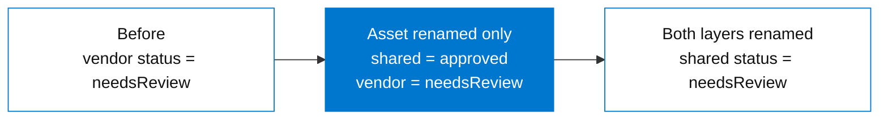

# Namespace and Prefix Isolation for USD Extensions

**Author:** Aaron Luk (NVIDIA)

**Status:** Draft

## Summary

Teams developing USD extensions need to know which names they can use. People
and tools reading a USD file need to know what those names mean and who governs
them. This proposal calls for one naming reservation per extension. Its owner can
publish names within that scope and delegate parts of it to others.

This work develops the Namespace and Prefix Isolation requirement in
the Steering Committee's working proposal, led by Sean Snyders.
[USD Extension Ecosystem Governance](https://docs.google.com/document/d/1zL7Igy5QN6bTHZavczkjaW2U5TBk95hP_Ooa_zL-tJc/edit)

> [!NOTE]
> **Review order.** The current review starts with the
> [Problem Statement and Scope](#problem-statement-and-scope), illustrated by
> the render settings example. Agreement on the problem and its scope provides the basis
> for reviewing the [Functional Requirements](#functional-requirements).

## Problem Statement and Scope

Two projects can give different definitions the same name. A tool may then
encounter a registration error or use the wrong definition. Even if two API
schemas have distinct names, their properties can collide on the same prim.
A layer can also author a property value while another layer supplies the type
that gives it meaning.

The initial scope covers type names, applied API schema identifiers, and property
names, with mappings to metadata, capability, and profile identifiers.
File-format and asset-resolver identifiers are future work. Naming authority
can be settled independently of feature approval, implementation support,
compatibility, versioning, and distribution.

Renderer developers already use naming conventions to define settings
independently on the same standard USD type. AOUSD has yet to publish formal
guidance on these practices or on how extension authors in other domains can
apply them. Render settings provide a concrete starting point for that guidance.

### Worked example in USD render settings

Suppose a scene author wants a 1920 × 1080 beauty image. USD defines
`resolution` and `products` on `RenderSettings`. The scene author sets the
resolution and points `products` at the desired output. Now suppose a renderer
developer wants scene authors to be able to save an additional setting. Which
name can the developer use, and how will someone reading the file find its
definition?
[OpenUSD render settings](https://openusd.org/release/api/class_usd_render_settings.html)

RenderMan defines its options in `PxrOptionsAPI`, which its plugin auto-applies
to `RenderSettings`. When Apple’s Dhruv Govil asked how to register a specialized
`RenderSettings` type for a Hydra renderer he was prototyping, Sebastian Grassia
explained why they had envisioned auto-applied APIs. A scene author can set
renderer-specific options on a standard `RenderSettings` prim, and other
renderers can still read its resolution and products.
[RenderMan example](https://forum.aousd.org/t/how-to-get-which-autoapply-schemas-apply-to-a-certain-type/527/3) · [Forum exchange](https://forum.aousd.org/t/runtime-schema-registration/1162)

SideFX documents how a scene author can set `karma:global:embreerobust` to
`true` for more accurate ray intersections. In Autodesk's Arnold example, the
scene author sets a custom sampling attribute, `arnold:AA_samples`, to `3`.
[Karma setting](https://www.sidefx.com/docs/houdini/nodes/lop/rendersettings.html#embree-robust-option) · [Arnold scene](https://github.com/Autodesk/arnold-usd/blob/f2517e99175f2d7a0d10306efaab607f02194c09/testsuite/test_2131/data/test.usda)

For multi-GPU path tracing in Omniverse, NVIDIA defines the boolean property
`omni:rtx:pt:multigpu:enabled`. In this illustrative excerpt, the scene author
requests that behavior by setting the property to `true` for the beauty render.
[RTX path-tracing settings](https://nvidia-omniverse.github.io/ovrtx/0.7.0/sensors/cameras/render_modes/path_tracing.html)

```usda
def RenderSettings "Settings"
{
    uniform int2 resolution = (1920, 1080)
    rel products = [</Render/Beauty>]
    bool omni:rtx:pt:multigpu:enabled = true
}
```

**How would a developer choose a name for the next setting?** Suppose NVIDIA
held the following reservation for its RTX multi-GPU controls.

| Naming owner | Property scope | Where to find the definition |
|---|---|---|
| NVIDIA | `omni:rtx:pt:multigpu` | `OmniRtxSettingsGlobalPtAdvancedAPI_1` in the [RTX schema package](https://docs.omniverse.nvidia.com/kit/docs/omni.usd.schema.render_settings.rtx/1.0.3/Overview.html) |

An RTX developer could choose an unused name within NVIDIA’s reserved scope.
A developer publishing a different renderer’s settings could do the same
within that renderer project’s scope.

**How does a reader find the definition?** The file gives the property's name
and value. A tool with the record above could match the prefix, identify NVIDIA
as the owner, and look up the full property name in the referenced schema.

Kit can auto-apply the RTX API, so the scene author can set the property
without writing the API name into the file. A reader without the plugin can
still read `true`. If the asset requires the feature, should its Profile
declare that capability and point back to the reservation? For a custom
attribute such as Arnold's `arnold:AA_samples`, what definition, if any,
should the reader expect to find?
[Kit settings](https://docs.omniverse.nvidia.com/kit/docs/omni.usd.schema.render_settings.rtx/1.0.3/SETTINGS.html)

### From renderer practice to AOUSD guidance

The `karma:` and `arnold:` prefixes let a scene author put options for both
renderers on one prim. RenderMan shows how a plugin can supply the definitions
for its options while the scene author continues to use standard render settings.

What guidance could a sensor project take from those practices? Its developers
also need to choose names for an API schema and its properties. Telling them
to “pick a prefix” leaves two questions open. How do they know which names
they are entitled to use? When someone encounters one of those names in an
asset, how do they find the definition? The sample RTX reservation illustrates
one way to answer both.

> [!NOTE]
> **Before reviewing the requirements.** Is the naming problem clear, and does
> the proposed scope cover the right names? If either is unclear or disputed,
> review should focus on this section first.

## Functional Requirements

The proposed requirements describe what any extension author or reader should
be able to rely on. They start with choosing distinct, recognizable names
and follow those names through publication, use in other tools, and changes
in who governs them.

<a name="r1-consistent-prefixes"></a>

### Consistent Prefixes

Ownership prefixes must be consistent for names governed by the same owner.

> **Example.** A developer adding an Arnold option alongside `arnold:AA_samples`
> could use the same `arnold:` prefix. A scene author could recognize both as Arnold options.

<a name="r2-hierarchy-and-delegation"></a>

### Hierarchy and Delegation

Owners can organize their naming hierarchy and delegate parts of it however
they choose.

> **Example.** A robotics project could let its camera group name camera
> properties and its lidar group name lidar properties under the project's prefix.

<a name="r4-one-reservation-across-surfaces"></a>

### One Reservation Across Surfaces

One reservation must cover an extension's names across all naming surfaces.
The naming rules must prevent collisions on every surface.

> **Example.** ROS uses `RosContextAPI` for a schema and `ros:` for properties.
> Reserving only `ros:` would leave the schema name open to a second claim.
> [ROS case study](#ros-and-newton)

<a name="r5-naming-allocations"></a>

### Naming Allocations

Record who controls each naming scope, and allocate scopes so independent
owners' names remain distinct.

> **Example.** Two renderers might each define a control called `samples` and
> count different things. If each developer qualifies `samples` with their own
> allocated prefix, a scene author can set both values on one `RenderSettings` prim.

<a name="r6-ownership-and-naming-transitions"></a>

### Ownership and Naming Transitions

Support ownership and naming transitions, especially promotion toward shared
ownership or standardization. Define how existing names and content are handled.

> **Example.** Suppose a vendor's render option becomes a standard setting.
> A studio reopening an old shot needs to know what its vendor-prefixed name
> still means and whether to keep using it.

<a name="r7-lightweight-administration"></a>

### Lightweight Administration

Reserving and maintaining a naming scope must require minimal process.

> **Example.** Once the robotics project has reserved its scope, adding a
> camera property could be a decision for its camera group alone.

<a name="r8-implementation-independence"></a>

### Implementation Independence

The naming rules, and any validation checks defined, must work in any USD
implementation.

> **Example.** Given the RTX property and the sample reservation above, a Kit
> tool and an independent USD reader could both identify NVIDIA as its naming owner.

<a name="r9-validation-scope-and-cost"></a>

### Validation Scope and Cost

When validation is performed, it must say what it checked and couldn't determine,
without excessive runtime cost.

> **Example.** A studio checking 100 shots that use the same render option
> could look up its reservation once. If the schema were missing, the report
> could say “Owner confirmed. Expected property type unknown.”

---

> [!NOTE]
> **End of the current review.** Do the requirements cover what extension
> authors and readers need across domains? A concrete use case can show
> where a requirement is missing or unclear.
>
> The remaining sections are available for reference. Review of the proposed
> solutions follows agreement on the problem, scope, and requirements.

## Terminology

- **Owner:** A vendor, project, collaboration, or standards body authorized to
  govern names. This is naming authority, separate from intellectual-property
  ownership of assets or implementations.
- **Extension:** Related definitions governed by an owner, regardless of packaging.
- **Reservation:** A record allocating an extension's naming scope to its owner.
  Its identifier need not appear in schema names.
- **Prefix:** Leading tokens identifying ownership or scope.
- **Namespace:** Names scoped by a prefix or equivalent qualification.
- **Naming surface:** Identifiers sharing syntax and a lookup context, such as
  type names or property names.

Ownership, maturity, version, and implementation support are separate facts.
`Prelim` describes maturity, not ownership or reservation lifetime. Implementing
someone else's definition retains its identity and naming authority.

## Naming Contract

<a name="reservation-and-delegation-r1-r2-r5-r7"></a>

### Reservation and Delegation

See [Consistent Prefixes](#consistent-prefixes), [Hierarchy and Delegation](#hierarchy-and-delegation),
[Naming Allocations](#naming-allocations), and [Lightweight Administration](#lightweight-administration).

Suppose `Yoyodyne` reserves a fictional review-tag extension as `ext-0107`.
The record identifies the owner, allocated scope, contact/status information,
and any delegation or transition. A brand or product name alone grants no scope.

Yoyodyne may govern several extensions and delegate sub-scopes however it
chooses. Owner hierarchies need not mirror domain or feature hierarchies.
Allocations must keep independent definitions distinct, including extensions
under the same owner, and keep ownership prefixes consistent.

Reservation can precede a finished specification, implementation, or commitment
to publish. Owners introduce conforming names within their allocation without
individual approvals. Administrative review concerns naming authority;
semantic review follows the broader governance process.

Keep owner, contact, status, and update authority current through a lightweight
process. Record when an owner is unreachable or maintenance stops.
Inactivity alone neither reassigns names nor invalidates existing
content. Review cadence, expiry, renewal, and reuse remain open; the
[maintenance precedents](#registry-maintenance-precedents) distinguish them.

<a name="names-across-surfaces-r4"></a>

### Names Across Surfaces

See [One Reservation Across Surfaces](#one-reservation-across-surfaces).

Per-surface rules must connect every covered identifier unambiguously to its reservation.
Consider owner `Yoyodyne` and domain/feature components `asset`, `review`.
Two candidate mappings, informed by the [standards survey](#precedents-and-alternatives),
illustrate the choices:

- **A. Declared prefixes:** record compact schema and property prefixes.
- **B. Encoded hierarchy:** derive names from recorded components.

| Surface | A. Declared prefixes | B. Encoded hierarchy |
|---|---|---|
| Reservation identifier | `ext-0107` | `ext-0107` |
| Concrete type | `YoyodyneReviewSet` | `Yoyodyne_asset_review_Set` |
| API definition | `YoyodyneReviewAPI` | `Yoyodyne_asset_review_API` |
| Applied API instance | `YoyodyneReviewAPI:qa` | `Yoyodyne_asset_review_API:qa` |
| API property | `yoyodyne:review:qa:status` | `yoyodyne:asset:review:qa:status` |
| Concrete-schema property | `itemCount` | `itemCount` |

These fictional examples select no convention. Both illustrate owner-first
names; token order and casing remain open. `qa` is an instance name, not ownership
qualification. Metadata and capability/profile identifiers need their own
mapping and may use a different grammar, including dots.

A gives shorter names and can retain prefixes through descriptive reorganizations,
but requires maintained per-surface records. B exposes more hierarchy, but
changes to encoded components may rename content unless old encodings are retained.
Both need precise collision rules:

- A must delimit prefixes or restrict local suffixes: `YoyodyneReview` + `ExtraAPI`
  and `YoyodyneReviewExtra` + `API` both produce `YoyodyneReviewExtraAPI`.
- B needs escaping or component restrictions: joining `asset_review` or the
  pair `asset`, `review` with underscores gives the same result. Case conversion
  must also preserve distinct scopes.

Keep internal implementation names distinct from names authored into content.
Legal spelling alone does not prove isolation. Reservation keys, authored
`typeName` tokens, schema-source prim names, and generated language identifiers
have different constraints. A dotted token accepted in USDA is not thereby a
legal schema-source prim name or C++ identifier. See the
[OpenUSD schema-generation rules](https://openusd.org/release/api/_usd__page__generating_schemas.html).

#### Concrete-schema properties

Under the proposed exception, `itemCount` may omit an added ownership prefix
because its qualified concrete type and definition supply that context.
The exception's scope for properties supplied by built-in APIs remains open.

OpenUSD combines one composed type with applied API properties in a
[prim definition](https://openusd.org/release/api/_usd__page__object_model.html).
[Sphere](https://openusd.org/release/api/class_usd_geom_sphere.html) and
[Cylinder](https://openusd.org/release/api/class_usd_geom_cylinder.html) both declare
`radius`. This provides type context, not a private property namespace: applied
APIs contribute to the same prim and still need isolated names.
[Definition strength](https://openusd.org/release/api/_usd__page__generating_schemas.html)
resolves precedence; it does not prevent independent naming claims.

A property opinion in another layer can rely on the resolved type. Without that
type or its definition, ownership may be unknown. Changing the type can
reinterpret surviving opinions, which transition guidance must address.

<a name="awareness-and-validation-r8-r9"></a>

### Awareness and Validation

See [Implementation Independence](#implementation-independence) and
[Validation Scope and Cost](#validation-scope-and-cost).

A delivery preflight could identify an asset's naming scopes and available definitions.
[Appendix A](#appendix-a-a-delivery-naming-check) follows the review-tag extension
through conforming, nonconforming, and insufficient-input cases. This helps
decide whether a check is useful before choosing its deployment:

| Option | Contract | Deployment |
|---|---|---|
| A. Optional checking | Define checks, inputs, and scoped results. | Adopters choose when to run them. |
| B. Required preflight | Require named checks at agreed publication/delivery boundaries. | Specify the actor and treatment of failures or unknowns. |
| C. Awareness first | Define scope identification; defer the validation contract. | Set coverage and obligations in later work. |

None is selected. The [standards precedents](#awareness-and-validation-precedents)
separate naming conformance, runtime capability checks, and ownership claims.
These choices do not remove syntax or lookup checks needed to interpret data.

If validation is included, distinguish allocation/delegation checks on
**reservations**, naming checks on **definitions**, and checks on **content**
using available layers, definitions, and reservation information. Report the
inputs examined and distinguish intended reuse, nonconformance, and missing
context. Report conflicts instead of silently substituting a definition.
Missing definitions do not establish invalid content or universal lack of support.

Checks may use supplied records or snapshots; no live-registry lookup is assumed.
Results may be reused while their stated conditions hold. Full validation need
not run on every composition or value query. Rules and diagnostics must work
without OpenUSD's plugin system,
schema registry, code generator, or dynamic loading; its
[`usdValidation` framework](https://openusd.org/dev/api/md_pxr_2usd_validation_2usd_validation_2_r_e_a_d_m_e.html)
is one implementation reference.

<a name="ownership-changes-r6"></a>

### Ownership Changes

See [Ownership and Naming Transitions](#ownership-and-naming-transitions).

Promotion from vendor ownership toward shared ownership or standardization is
the lead case. Wider adoption or maturity alone need not change authority or
rename content. A transition policy must link predecessor/successor scopes and
names, and address existing or mixed content, grace periods, and incompatible
revisions. Automatic aliasing is not assumed.

[Appendix B](#appendix-b-promotion-and-existing-layers) deliberately renames the
review-tag extension. Renaming the asset alone leaves a shot override targeting
the old property. The case tests what guidance and proposed prototype tooling
must cover across contributing layers.

Naming transitions do not supply semantic conversion. OpenUSD's
[schema-versioning design](https://openusd.org/dev/wp_schema_versioning.html)
similarly gives `Cylinder` and `Cylinder_1` separate definitions without automatic
translation of old properties. The [implementation plan](#implementation-plan)
defines the proposed deliverables.

## Precedents and Alternatives

These systems show how allocation and identity can remain separate from
per-surface spelling. Their conventions inform the candidates above.

| System and primary source | Relevant precedent |
|---|---|
| [glTF process](https://github.com/KhronosGroup/glTF/blob/main/extensions/README.md) and [prefix registry](https://github.com/KhronosGroup/glTF/blob/main/extensions/Prefixes.md) | Reserve vendor prefixes before feature completion. `PREFIX_scope_feature` identifies an extension; fields such as `offset` are local to its JSON object. USD APIs create no equivalent property container. |
| [OpenGL registry](https://github.com/KhronosGroup/OpenGL-Registry/blob/main/README.adoc#defining-new-extensions) and [naming rules](https://github.com/KhronosGroup/OpenGL-Registry/blob/main/docs/syntaxrules.txt) | Reserve enumerant blocks before completion. Author tags prefix extension names but suffix commands/enumerants. |
| [Vulkan extension names](https://github.com/KhronosGroup/Vulkan-Docs/blob/main/style/extensions.adoc#version-extension-and-layer-naming-conventions) and [identifier names](https://github.com/KhronosGroup/Vulkan-Docs/blob/main/style/naming.adoc#extension-identifier-naming-conventions) | Register author IDs and `VK_<author>_<name>` extensions; types/commands use author suffixes. `VkSurfaceFormatKHR` has local members `format` and `colorSpace`. |
| [XML Namespaces](https://www.w3.org/TR/xml-names/#dt-expname) | URI plus local name establishes identity; document prefixes are aliases. Similar USD aliasing would need binding and interchange rules. |
| [IETF media types](https://www.rfc-editor.org/rfc/rfc6838.html#section-3.2) | Register type/subtype names and change control; the vendor tree uses `vnd.`. Format identifiers do not prescribe all field names, and IETF procedures include review. |
| [HTML custom elements](https://html.spec.whatwg.org/multipage/custom-elements.html#valid-custom-element-name) | A hyphen marks custom names; scoped registries provide lookup context. The marker alone does not allocate ownership or cross-registry identity. |
| [USD Profiles and Capabilities](https://github.com/PixarAnimationStudios/OpenUSD-proposals/tree/main/proposals/profiles) | Dotted identifiers such as `yoyodyne.dimensional.contabulator` name capabilities in an adjacent system, not schema-source prims. |

Promotion also need not follow a rename ladder. glTF permits `KHR` before
ratification and some ratified extensions retain `EXT`. Vulkan retains earlier
identifiers for source compatibility when adding core forms. Historical
[OpenGL guidance](https://registry.khronos.org/OpenGL/docs/promoting.html)
distinguishes unchanged from changed behavior.

Package qualification is another possible approach; it would still need stable
identity and binding rules across dependency sets and separately authored layers.

### Registry maintenance precedents

- [glTF prefixes](https://github.com/KhronosGroup/glTF/blob/main/extensions/Prefixes.md)
  record company/project and contacts.
  [Vulkan author IDs](https://registry.khronos.org/vulkan/specs/latest/registry.html#tag-tag)
  distinguish original and current responsibility.
- [Published media types](https://www.rfc-editor.org/rfc/rfc6838.html#section-5.5)
  retain registrations, allow obsolete status and stewardship transfer, and permit
  IESG reassignment for unreachable owners. Their
  [provisional names](https://www.rfc-editor.org/rfc/rfc6838.html#section-5.2.1)
  can instead be abandoned and reused.
- [PENs](https://www.rfc-editor.org/rfc/rfc9371.html#section-2.2) authorize record
  changes, delay reuse of returned numbers until unassigned values are exhausted,
  and involve IESG when ownership is unclear.

These distinguish upkeep, retirement, and reuse; USD must choose its own policy.

### Awareness and validation precedents

- [glTF](https://registry.khronos.org/glTF/specs/2.0/glTF-2.0.html#specifying-extensions)
  declares used/required extensions. Its separate
  [Validator](https://github.com/KhronosGroup/glTF-Validator/blob/main/ISSUES.md)
  treats undeclared use as an error and unsupported validation coverage as
  informational.
- [Vulkan validation layers](https://registry.khronos.org/vulkan/specs/latest/html/vkspec.html#fundamentals-validation)
  provide optional usage checks, while
  [instance creation](https://docs.vulkan.org/refpages/latest/refpages/source/vkCreateInstance.html)
  still rejects unsupported requested extensions.
- [XML processors](https://www.w3.org/TR/xml-names/#Conformance) report
  namespace-well-formedness errors without authenticating control of namespace URIs.

These practices select neither mandatory runtime ownership checks nor an
exemption from input checks for USD.

## Case Studies

B-Rep and ROS already make the naming and staging choices this proposal addresses.
They show why official AOUSD naming guidance is needed now. Both approaches may
need iteration as that guidance is agreed.

### B-Rep

The [B-Rep prefix change](https://github.com/aousd/OpenUSD-proposals/pull/2), in the
[reviewed revision](https://github.com/umhoefer/OpenUSD-proposals/commit/3f3350ae7bf45cc9c06c2d566223d3579c0aacc1),
uses these choices:

- **Type and library:** `PrelimBrepArray` and `PrelimUsdSolid` carry a maturity marker.
- **APIs and properties:** names such as `BrepPointAPI` and `BrepCurve3dNurbAPI`
  omit `Prelim`; properties use `brep:`.

Joe Umhoefer [explained](https://nvidia.enterprise.slack.com/archives/C03HVL2A61Z/p1789171505169859)
that he left geometry APIs unchanged because they applied only to
`PrelimBrepArray`; the domain was already `PrelimUsdSolid`. Applicability does
not qualify an API identifier. `apiSchemaCanOnlyApplyTo` guides
[`CanApplyAPI`](https://github.com/PixarAnimationStudios/OpenUSD/blob/v26.08/pxr/usd/usd/prim.cpp#L645);
[`ApplyAPI`](https://github.com/PixarAnimationStudios/OpenUSD/blob/v26.08/pxr/usd/usd/prim.cpp#L825)
does not itself enforce that list.

Geometry Working Group stewardship spans organizations. Guidance must relate
all surfaces to a governing owner, separately from maturity.
The concrete-property exception does not automatically cover
API properties. A type rename alone also leaves API and property transitions
unresolved. Final B-Rep spellings remain work for its authors under agreed guidance.

### ROS and Newton

[REP 158](https://reps.openrobotics.org/rep-0158-2006/) makes separate choices for
ROS interfaces and physics staging:

- **ROS interfaces:** the [reviewed schema](https://github.com/ros-simulation/openusd-schemas/blob/6d154f2a17c4494c2eee12a95945ac106e329db6/core/ros/schema.usda)
  uses `RosContextAPI`, `ros:` properties, and internal `UsdRos`. Runtime ROS
  namespaces such as `/robot_1/camera` serve a different purpose.
- **Physics staging:** the [reviewed REP revision](https://github.com/openrobotics/reps/blob/8477d6f726a0572dc6c07b6bd5ce33d5e30e90a2/_posts/rep-0158:2006.md)
  places unratified features in vendor layers (`mjc:`, `newton:`, `physx:`),
  then migrates to `physics:` after AOUSD ratification. It removed an interim
  `ext_physics:` namespace and anticipates adopting official AOUSD mechanisms.

AOUSD guidance needs to distinguish governing projects from implementations:
a [Newton](https://github.com/newton-physics)-governed definition can be shared
by several engines. The ROS staging choices need to be assessed against that
ownership model and the agreed transition rules.

## Open Questions

1. Which reservation format and mapping should be selected? Set surface prefixes
   or encoding rules, boundaries/escaping, and metadata/profile links.
2. Which properties inherit concrete-type qualification, especially those from
   built-in APIs? What context is needed after a type change?
3. Who maintains allocations and authorizes updates? Set status, review cadence,
   and any expiry, renewal, or name-reuse policy.
4. Which validation option is useful? If included, define inputs, coverage,
   deployment, cost, and treatment of unknown results.
5. Which names change during a transition? Define any grace periods or aliases,
   mixed-content rules, and treatment of allocation identifiers.
6. Who owns each deliverable and its maintenance, and when and where is it
   reviewed? Agree prototype coverage and completion evidence.

## Implementation Plan

- **Reservation and naming:** define a lightweight procedure and per-surface
  rules, including delegation and adjacent identifiers. Demonstrate distinct
  scopes across owners and between extensions under one owner.
- **Awareness and any adopted checks:** define how tools identify scopes. If
  validation is included, specify portable rules and conforming, conflicting,
  nonconforming, and insufficient-input cases.
- **Transitions:** provide guidance and prototype tooling using an explicit
  naming-only mapping. Produce migrated copies while preserving originals and
  values apart from mapped names and paths. Exercise type/API/property names,
  supported property-path references, separate-layer opinions, and mixed old/new
  content. Report edits, remaining old names, unresolved mappings, and unsupported forms.

B-Rep and ROS/Newton test real naming surfaces. The appendices give a controlled
delivery and promotion case. Prototype implementation, detailed coverage, owners,
review dates, and approval routes remain to be agreed.

## Appendix A: A Delivery Naming Check

This fictional case uses candidate A. It selects no validation policy.

A pipeline TD receives a vendor asset and a stronger shot override before
integration. Allocation `ext-0107` supplies prefixes `YoyodyneReview` and
`yoyodyne:review`; the asset uses `YoyodyneReviewSet` and `YoyodyneReviewAPI:qa`.


The check would expose missing or inconsistent naming information before integration:

| Delivery variation | Expected finding |
|---|---|
| Complete supplied definitions | Names conform within the checked inputs. |
| `YoyodyneReviewAPI` definition missing | Its prefix may match, but API/property-definition checks remain unknown. |
| API definition introduces `review:qa:status` | Outside the assumed `yoyodyne:review` prefix, despite legal USD syntax. |

The unprefixed `itemCount` needs the resolved concrete type and definition for
ownership context. Missing context means unknown, not invalid content.

**Discuss:** Is this useful at delivery? Agree the inputs, actor, and treatment
of unknown results before selecting optional checks or required preflight.
Deferral remains an option.

## Appendix B: Promotion and Existing Layers

Continuing [Appendix A](#appendix-a-a-delivery-naming-check), other organizations
adopt review tags and `SharedWG` accepts naming stewardship. Keeping deployed
names is an option. To test a rename, assume unchanged semantics and this mapping:

| Surface | Vendor | Shared stewardship |
|---|---|---|
| Concrete type | `YoyodyneReviewSet` | `SharedWGReviewSet` |
| Applied API | `YoyodyneReviewAPI:qa` | `SharedWGReviewAPI:qa` |
| API property | `yoyodyne:review:qa:status` | `sharedwg:review:qa:status` |

`itemCount` and instance `qa` remain unchanged. Records must link the authorities;
whether identifier `ext-0107` changes is a separate choice.

The asset authors `approved`; a stronger shot layer overrides the same vendor
property to `needsReview`. Renaming only the asset leaves that override
targeting the old property:



"Vendor" and "shared" refer to the full property names above. Both opinions
survive the partial rename, but the new property keeps the asset's original
value. Mapping both layers restores the shot override's effect. These
authored-layer results were checked in OpenUSD 26.08.

**Discuss:** Must promotion rename content? Which old names remain usable, for
how long, and what happens when a contributing layer cannot be edited?

**Prototype evidence:** migrate copies of both layers, preserve originals and
the composed value, and report remaining old names or unresolved mappings.
Semantic conversion remains separate work; the prototype is a proposed deliverable.
