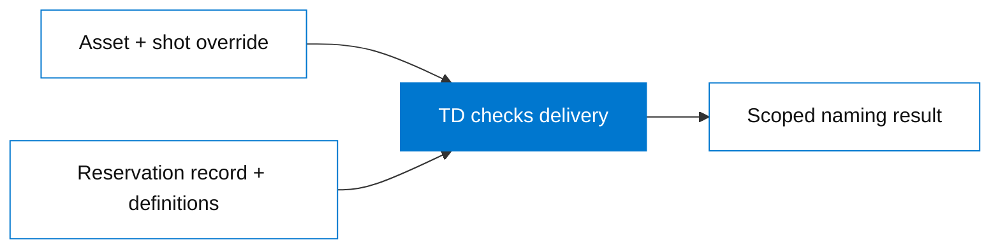
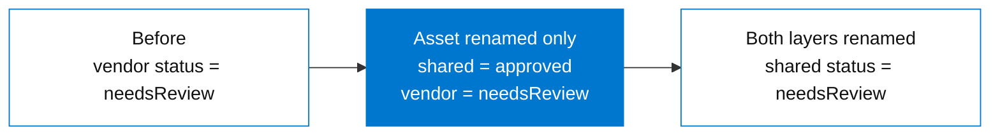

# Namespace and Prefix Isolation for USD Extensions

**Initial author:** Aaron Luk (NVIDIA); co-authors welcome

**Status:** Working draft for joint authorship

## Problem and scope

USD extensions need distinct names so they can develop independently and exchange
content without name collisions. If two projects publish different definitions
under the same name, a tool can encounter a registration conflict or use the
wrong definition. Qualifying an API schema's name alone leaves room for its properties to
collide with those of another API on the same prim.

An author needs to know which names their project can issue. Someone receiving
an asset needs to know which definition a name refers to and who governs it.
Once a project has a naming scope, it should be able to publish extensions
within it or delegate a narrower scope to another team without
seeking ecosystem-wide agreement on each feature. If a vendor extension later
becomes a shared standard, readers still need to understand existing assets.

This proposal develops the Namespace and Prefix Isolation requirement in the
[Steering Committee's extension governance working proposal](https://docs.google.com/document/d/1zL7Igy5QN6bTHZavczkjaW2U5TBk95hP_Ooa_zL-tJc/edit),
led by Sean Snyders.
The first naming surfaces to work through are concrete types, API schemas, and
properties. Metadata, capability and profile identifiers, and file-format plugins
raise further mapping questions. Feature semantics and implementation support
belong to broader extension governance. The
[case studies](#case-studies) show where authors need guidance today.

## Terminology

- **Owner:** The vendor, project, collaboration, or standards body on whose behalf
  a scope is reserved and governed. Authority over those names is separate from
  administering reservation records and from intellectual-property ownership.
- **Extension:** A named addition to USD, potentially comprising several
  definitions, such as a schema type and related APIs. Whether the
  reservable unit is a feature group, a single schema, or something else remains
  open; packaging need not define it.
- **Reservation:** A recorded assignment of a naming scope to an owner.
- **Name binding:** The link from a reservation to names on a particular naming
  surface, specified through explicit names, prefixes, or mapping rules.
- **Prefix:** Leading tokens identifying ownership or scope.
- **Namespace:** Names scoped by a prefix or equivalent qualification.
- **Naming surface:** Identifiers sharing syntax and a lookup context, such as
  type names or property names.

Ownership, maturity, version, and implementation support are separate facts.
`Prelim` describes maturity, not ownership or reservation lifetime. An
implementation can have its own name while preserving the identity and naming
authority of the definitions it uses.

## Functional Requirements

R3 is incorporated into R2; other labels are retained for review. The aim is to
distinguish independent definitions while allowing shared use of a definition
or file format.

### R1. Consistent Prefixes

Ownership prefixes must be consistent for names governed by the same owner.

### R2. Hierarchy and Delegation

Owners can organize their naming hierarchy and delegate parts of it however
they choose.

### R4. One Reservation Across Surfaces

One reservation must cover an extension's names across all naming surfaces.
The naming rules must prevent collisions on every surface.

### R5. Naming Reservations

Record who controls each naming scope, and reserve scopes so independent
owners' names remain distinct.

### R6. Ownership and Naming Transitions

Support ownership and naming transitions, especially promotion toward shared
ownership or standardization. Define how existing names and content are handled.

### R7. Lightweight Administration

Reserving and maintaining a naming scope must require minimal process.

### R8. Implementation Independence

The naming rules, and any validation checks defined, must work in any USD
implementation.

### R9. Validation Scope and Cost

When validation is performed, it must say what it checked and couldn't determine,
without excessive runtime cost.

## Candidate Approaches

### Reservation and Delegation (R1, R2, R5, R7)

As an interim procedure, a shared list could record each top-level grant,
its owner, and the owner's published bindings. An applicant would submit an
unused scope and a contact to the list's maintainer. A delegate would obtain
its grant from the enclosing owner, who would publish the narrower scope and
its responsible party. A reader could follow those grants to the definitions.
The owner would set its own review process for additions inside its grant. Competing
claims would go to the owner of the enclosing scope or, for top-level claims,
to the list's maintainer. Choosing a maintainer remains an adoption decision.

A team can reserve its scope before the feature is ready. It can add a reference
to the definitions when it publishes them.

Keep owner, contact, status, and update authority current. Mark unreachable
owners and unmaintained extensions. Inactivity alone neither reassigns names nor
invalidates content. Review cadence, expiry, renewal, and reuse remain open;
the [maintenance precedents](#registry-maintenance-precedents) distinguish them.

### Names Across Surfaces (R4)

Start with **declared prefixes**. One reservation records the spellings used on
each surface. A schema identifier and a colon-separated property can express
the same authority with different syntax. The owner chooses its internal hierarchy.
Other standards also vary the spelling across surfaces. [Survey](#precedents-and-alternatives)

**Candidate boundary rule.** On the schema surface, compare the literal,
case-sensitive prefixes. Two independent grants overlap if either prefix starts
with the other. On the property surface, compare whole colon-delimited components:
`ros:context` contains `ros:context:domain_id`, while `ros:contextual` is a
different branch. Allow a narrower grant only through explicit delegation.
Reserve that part for the delegate and check existing names before granting it.
Within a grant, check the full identifier against existing definitions, including
any schema version suffix. For a multiple-apply API, bind the schema identifier
and property template at definition time. An author's instance name fills the
template when the API is applied.

For example, independent schema grants for `YoyodyneReview` and
`YoyodyneReviewExtra` would both cover `YoyodyneReviewExtraAPI`.
The proposed rule catches the overlap when the second grant is requested.
Its cost is that one short prefix can exclude many longer ones. Test that cost
against deployed names before adoption. [Appendix A](#review-tag-example)
shows a fictional record, concrete type, applied API, and authored property.

An alternative encodes every component in the USD name, for example
`Yoyodyne_asset_review_Set`. That makes hierarchy visible, but needs escaping
or component restrictions to distinguish `asset_review` from `asset` followed
by `review`. Moving a feature in the hierarchy can also change its authored name.

Legal spelling alone does not prove isolation. Record IDs, authored USD names,
schema-source prim names, and generated symbols have different syntax and lookup
rules. Spellings may match where legal; private code symbols are outside this
proposal. A dotted USDA token may still be illegal as a schema-source prim name
or C++ identifier. See the
[OpenUSD schema-generation rules](https://openusd.org/release/api/_usd__page__generating_schemas.html).

#### Property Naming Exception

Under the proposed exception, `itemCount` may omit an ownership prefix because
its qualified concrete type and definition supply that context.
[Sphere](https://openusd.org/release/api/class_usd_geom_sphere.html) and
[Cylinder](https://openusd.org/release/api/class_usd_geom_cylinder.html) both declare
`radius`, illustrating type context. API properties contribute to the same
[prim definition](https://openusd.org/release/api/_usd__page__object_model.html);
a qualified API schema identifier does not itself qualify its property names.
[Definition strength](https://openusd.org/release/api/_usd__page__generating_schemas.html)
resolves precedence; it does not prevent independent naming claims.

[Spiff proposed](https://github.com/asluk/OpenUSD-proposals/pull/16#discussion_r4623096900)
extending this exception to built-in-only APIs under the extension's qualified
types or properly scoped APIs:

| Case | Proposed treatment or open question |
|---|---|
| A built-in API supplies `itemCount` only through `YoyodyneReviewSet` | Candidate exception if the qualified type supplies reliable ownership context. |
| A user-applied API supplies review status on other types | Keep isolated property names, such as `yoyodyne:review:qa:status`. |
| Two independently applied API schemas each bring a built-in `itemCount` | Qualified API identifiers alone do not isolate these properties; clarify allowed combinations. |

API schema identifiers still need collision prevention. The built-in-only boundary
remains open: its conformance rule, any enforcement, and how enclosing APIs combine.
Applicability hints alone do not settle those questions.

Property opinions in other layers rely on the resolved type and definition.
Missing context leaves ownership unknown; type changes can reinterpret surviving
opinions, which transition guidance must address.

### Awareness and Validation (R8, R9)

[Appendix A](#appendix-a-a-delivery-naming-check) follows a delivery check using
the review-tag extension. Its conforming, nonconforming, and insufficient-input
cases help assess usefulness before choosing deployment:

| Option | Contract | Deployment |
|---|---|---|
| A. Optional checking | Define checks, inputs, and scoped results. | Adopters choose when to run them. |
| B. Required preflight | Require named checks at agreed publication/delivery boundaries. | Specify the actor and treatment of failures or unknowns. |
| C. Awareness first | Define scope identification; defer the validation contract. | Set coverage and obligations in later work. |

None is selected. The [precedents](#awareness-and-validation-precedents)
distinguish naming conformance, runtime capability checks, and ownership claims.
Syntax and lookup checks needed to interpret data still apply.

If validation is included, distinguish checks on **reservations and delegation**,
**definition names**, and **content**. Report the inputs, intended reuse,
nonconformance, and missing context separately. Report conflicts instead of
silently substituting a definition. Missing definitions yield an unknown result,
not proof of invalid content or lack of support elsewhere.

Checks may use supplied records or snapshots and reuse results while their
conditions hold. A live lookup of reservation records or full validation on
every composition or value query is not assumed. Rules and diagnostics must work
without OpenUSD's plugin system, schema registry, code generator, or dynamic
loading. Its
[`usdValidation` framework](https://openusd.org/dev/api/md_pxr_2usd_validation_2usd_validation_2_r_e_a_d_m_e.html)
is one implementation reference.

### Ownership Changes (R6)

When a vendor extension gains broader adoption, a working group may take
responsibility for its definitions. The proposed default is to record the new
steward and retain deployed names. The record then explains why an old vendor
prefix appears in content governed by the group. A transition policy must link predecessor/successor scopes and
names, and address existing or mixed content, grace periods, and incompatible
revisions. Automatic aliasing is not assumed.

[Appendix B](#appendix-b-promotion-and-existing-layers) deliberately renames the
review-tag extension. Renaming the asset alone leaves a shot override targeting
the old property. The case exposes a migration error across contributing layers
even with unchanged semantics.

A rename does not supply semantic conversion. OpenUSD's
[schema-versioning design](https://openusd.org/dev/wp_schema_versioning.html)
similarly gives `Cylinder` and `Cylinder_1` separate definitions without automatic
translation of old properties. The [joint work](#joint-work) below identifies
contributions that could develop this approach.

## Precedents and Alternatives

These systems show how reservation and identity can remain separate from
per-surface spelling. Their conventions inform the candidates above.

| System and primary source | Relevant precedent |
|---|---|
| [glTF process](https://github.com/KhronosGroup/glTF/blob/main/extensions/README.md) and [prefix registry](https://github.com/KhronosGroup/glTF/blob/main/extensions/Prefixes.md) | Reserve vendor prefixes before feature completion. `PREFIX_scope_feature` identifies an extension; fields such as `offset` are local to its JSON object. USD APIs create no equivalent property container. |
| [OpenGL registry](https://github.com/KhronosGroup/OpenGL-Registry/blob/main/README.adoc#defining-new-extensions) and [naming rules](https://github.com/KhronosGroup/OpenGL-Registry/blob/main/docs/syntaxrules.txt) | Reserve enumerant blocks before completion. Author tags prefix extension names but suffix commands/enumerants. |
| [Vulkan extension names](https://github.com/KhronosGroup/Vulkan-Docs/blob/main/style/extensions.adoc#version-extension-and-layer-naming-conventions) and [identifier names](https://github.com/KhronosGroup/Vulkan-Docs/blob/main/style/naming.adoc#extension-identifier-naming-conventions) | Register author IDs and `VK_<author>_<name>` extensions; types/commands use author suffixes. `VkSurfaceFormatKHR` has local members `format` and `colorSpace`. |
| [XML Namespaces](https://www.w3.org/TR/xml-names/#dt-expname) | URI plus local name establishes identity; document prefixes are aliases. Similar USD aliasing would need binding and interchange rules. |
| [IETF media types](https://www.rfc-editor.org/rfc/rfc6838.html#section-3.2) | Register type/subtype names and change control; the vendor tree uses `vnd.`. Format identifiers do not prescribe all field names, and IETF procedures include review. |
| [HTML custom elements](https://html.spec.whatwg.org/multipage/custom-elements.html#valid-custom-element-name) | A hyphen marks custom names; scoped registries provide lookup context. The marker alone establishes neither ownership nor cross-registry identity. |
| [USD Profiles and Capabilities](https://github.com/PixarAnimationStudios/OpenUSD-proposals/tree/main/proposals/profiles) | Dotted identifiers such as `yoyodyne.dimensional.contabulator` name capabilities in an adjacent system, not schema-source prims. |

Promotion also need not follow a rename ladder. glTF permits `KHR` before
ratification and some ratified extensions retain `EXT`. Vulkan retains earlier
identifiers for source compatibility when adding core forms. Historical
[OpenGL guidance](https://registry.khronos.org/OpenGL/docs/promoting.html)
distinguishes unchanged from changed behavior.

Package qualification is another possible approach; it would still need stable
identity and binding rules across dependency sets and separately authored layers.

### Registry maintenance precedents

- [glTF prefixes](https://github.com/KhronosGroup/glTF/blob/main/extensions/Prefixes.md)
  record company/project and contacts.
  [Vulkan author IDs](https://registry.khronos.org/vulkan/specs/latest/registry.html#tag-tag)
  distinguish original and current responsibility.
- [Published media types](https://www.rfc-editor.org/rfc/rfc6838.html#section-5.5)
  retain registrations, allow obsolete status and stewardship transfer, and permit
  IESG reassignment for unreachable owners. Their
  [provisional names](https://www.rfc-editor.org/rfc/rfc6838.html#section-5.2.1)
  can instead be abandoned and reused.
- [PENs](https://www.rfc-editor.org/rfc/rfc9371.html#section-2.2) authorize record
  changes, delay reuse of returned numbers until unassigned values are exhausted,
  and involve IESG when ownership is unclear.

These distinguish upkeep, retirement, and reuse.

### Awareness and validation precedents

- [glTF](https://registry.khronos.org/glTF/specs/2.0/glTF-2.0.html#specifying-extensions)
  declares used/required extensions. Its separate
  [Validator](https://github.com/KhronosGroup/glTF-Validator/blob/main/ISSUES.md)
  treats undeclared use as an error and unsupported validation coverage as
  informational.
- [Vulkan validation layers](https://registry.khronos.org/vulkan/specs/latest/html/vkspec.html#fundamentals-validation)
  provide optional usage checks, while
  [instance creation](https://docs.vulkan.org/refpages/latest/refpages/source/vkCreateInstance.html)
  still rejects unsupported requested extensions.
- [XML processors](https://www.w3.org/TR/xml-names/#Conformance) report
  namespace-well-formedness errors without authenticating control of namespace URIs.

## Case Studies

### Renderer properties on a shared prim

A published RTX scene explicitly applies `OmniRtxSettingsMinimalAPI_1` to
a standard `RenderProduct`. It sets `omni:rtx:minimal:dlss:mode = 1` to select
DLSS Super Resolution. The API identifier and the property name have different
spellings. Under R4 and R5, a reader should be able to trace both to the same
reservation and its definitions. Another renderer team should be able to add
its own settings to that prim under its own scope.
[RTX scene](https://github.com/NVIDIA-Omniverse/ovrtx/blob/82d501220ad450dad7094f27fee7e2373ba8b50c/examples/python/minimal-dlss/minimal_dlss.usda) · [Setting definition](https://github.com/NVIDIA-Omniverse/ovrtx/blob/82d501220ad450dad7094f27fee7e2373ba8b50c/docs/sensors/cameras/render_modes/minimal.rst) · [Illustration](appendices/renderer-setting.png)

A related [RenderMan discussion](https://forum.aousd.org/t/how-to-get-which-autoapply-schemas-apply-to-a-certain-type/527/2)
illustrates a question that installed definitions can already answer. Which APIs
auto-apply to a type, including through its base types?

### B-Rep

The [B-Rep prefix change](https://github.com/aousd/OpenUSD-proposals/pull/2), in the
[reviewed revision](https://github.com/umhoefer/OpenUSD-proposals/commit/3f3350ae7bf45cc9c06c2d566223d3579c0aacc1),
uses these choices:

- **Type and library:** `PrelimBrepArray` and `PrelimUsdSolid` carry a maturity marker.
- **APIs and properties:** names such as `BrepPointAPI` and `BrepCurve3dNurbAPI`
  omit `Prelim`; properties use `brep:`.

Joe Umhoefer explained that he left geometry APIs unchanged because they applied
only to `PrelimBrepArray`; the domain was already `PrelimUsdSolid`. Applicability
does not qualify an API schema identifier. `apiSchemaCanOnlyApplyTo` guides
[`CanApplyAPI`](https://github.com/PixarAnimationStudios/OpenUSD/blob/v26.08/pxr/usd/usd/prim.cpp#L645);
[`ApplyAPI`](https://github.com/PixarAnimationStudios/OpenUSD/blob/v26.08/pxr/usd/usd/prim.cpp#L825)
does not itself enforce that list.

Geometry Working Group stewardship spans organizations. Guidance must identify
the naming owner separately from maturity. The property naming exception does
not automatically cover API properties, and a type rename leaves API and property
transitions unresolved. Final B-Rep spellings remain work for its authors under
agreed guidance.

### ROS and Newton

[REP 158](https://reps.openrobotics.org/rep-0158-2006/) makes separate choices for
ROS interfaces and physics staging:

- **ROS interfaces:** the [reviewed schema](https://github.com/ros-simulation/openusd-schemas/blob/6d154f2a17c4494c2eee12a95945ac106e329db6/core/ros/schema.usda)
  defines `RosContextAPI` and its property `ros:context:domain_id`. Runtime ROS
  namespaces such as `/robot_1/camera` serve a different purpose.
- **Physics staging:** the [reviewed REP revision](https://github.com/openrobotics/reps/blob/8477d6f726a0572dc6c07b6bd5ce33d5e30e90a2/_posts/rep-0158:2006.md)
  places unratified features in vendor layers (`mjc:`, `newton:`, `physx:`),
  then migrates to `physics:` after AOUSD ratification. It removed an interim
  `ext_physics:` namespace and anticipates adopting official AOUSD mechanisms.

**Try the guidance.** A ROS maintainer wants to add another property alongside
`ros:context:domain_id`. Given a grant covering `ros:context`, can they choose
an unused local name and publish its definition? Give a recipient the new name
and the grant. Can they follow its definitions link, find the declaration under
`RosContextAPI`, and identify who can approve a change? The existing schema
declares `ros:context:domain_id`; the grant in this exercise is hypothetical.
[Illustrated delegation exercise](appendices/delegated-authority.png)

AOUSD guidance needs to distinguish governing projects from implementations:
a [Newton](https://github.com/newton-physics)-governed definition can be shared
by several engines. The ROS staging choices need to be assessed against that
ownership model and the agreed transition rules.

### File Format Plugins: Shared Formats

[Adobe's SBSAR plugin](https://github.com/adobe/USD-Fileformat-plugins/blob/6441b97807a59472337f9c3d02df089d45ed1c48/sbsar/README.md)
provides a handler for `.sbsar` files. A second handler could be installed instead,
or both could arrive through dependencies. Existing filenames such as
`myfile.sbsar` must keep working.

**Starting hypothesis for discussion:** give handlers distinct public identifiers
while preserving `.sbsar`. Reserving a handler's names would not grant exclusive
authority to implement the format.

Adobe's [OpenUSD plugin metadata](https://github.com/adobe/USD-Fileformat-plugins/blob/6441b97807a59472337f9c3d02df089d45ed1c48/sbsar/src/plugInfo.json.in)
illustrates runtime registration names, separate from governance reservations:

| Aspect | Existing value |
|---|---|
| Plugin name / type name | `usdSbsar` / `SBSARFileFormat` |
| Handler lookup key | `formatId = sbsar` |
| File selection | filename extension `sbsar`, target `usd` |

[OpenUSD 26.08](https://github.com/PixarAnimationStudios/OpenUSD/blob/v26.08/pxr/usd/sdf/fileFormat.h#L334-L364)
allows multiple handlers for a filename extension through different targets.
Its [file-format registry](https://github.com/PixarAnimationStudios/OpenUSD/blob/v26.08/pxr/usd/sdf/fileFormatRegistry.cpp#L408-L451)
rejects duplicate format IDs and duplicate extension/target registrations.
A shared filename extension need not mean a shared `formatId`; distinct plugin names alone
do not establish coexistence.

[OpenUSD issue #4131](https://github.com/PixarAnimationStudios/OpenUSD/issues/4131#issuecomment-5401400163)
describes an apparent regression after a plugin changed without an OpenUSD update.
It motivates compatibility questions across implementations and versions; the
APIs and error handling remain implementation details.

**Open naming and governance questions:**

- What should a reservation identify: a format, an implementation, or both?
  Who governs each, and which names can implementations share?
- What should users be able to rely on in the resulting USD data when switching
  implementations or updating a plugin that claims the same format?
- Who selects the handler, and when must that choice travel with content?
  Which decisions belong in naming guidance, broader governance, or application
  configuration?

## Joint Work

Start with a schema author and an implementer. Have the author try the ROS
exercise and the implementer trace the name back. Record the first decision
either had to guess. Use B-Rep to test where property scope comes from and
ask a USD schema reviewer to check the application and composition behavior.
The following questions can advance in parallel.

| Topic | Initial contribution |
|---|---|
| Naming and property context | Test name bindings across and within owners; refine the property naming exception. Metadata, capability, and profile mappings also need contributors. |
| File format plugins | Work through one two-handler case and identify which naming and compatibility questions need shared guidance. |
| Registry upkeep | Sketch lightweight record maintenance and who can authorize changes. |
| Awareness and validation | Recommend an option using Appendix A or a publication/multi-owner case. |
| Promotion | Test Appendix B against a policy for old names and mixed content. |

### Possible Implementation Follow-up

As choices mature, volunteers could prototype scope identification, agreed naming
checks, or naming-only migration on copies. Migration should preserve values
apart from mapped names and paths, cover type/API/property names and supported
path references across layers and mixed content, and report edits, remaining old
names, and unresolved or unsupported forms. Contributors can agree coverage,
maintenance, and review.

## Appendix A: A Delivery Naming Check

### Review Tag Example

In this fictional example, Yoyodyne wants other tools to exchange its asset-review tags. It supplies
`review-schema.usda`, defining concrete schema type `YoyodyneReviewSet` with
`itemCount`, and multiple-apply API schema `YoyodyneReviewAPI` with a review
`status` per named instance.

An illustrative reservation record using the
[declared-prefix candidate](#names-across-surfaces-r4):

```json
{
  "id": "yoyodyne.review-tags",
  "owner": "Yoyodyne",
  "definitions": "review-schema.usda",
  "schemaPrefix": "YoyodyneReview",
  "apiPropertyPrefix": "yoyodyne:review"
}
```

The `id` names this record; it implies no global counter. An asset might contain:

```usda
#usda 1.0
def YoyodyneReviewSet "Reviews" (
    prepend apiSchemas = ["YoyodyneReviewAPI:qa"]
)
{
    int itemCount = 2
    token yoyodyne:review:qa:status = "approved"
}
```

The prefixes and definitions bind the schema and property names to the reservation.
Here `qa` names an API instance; unprefixed `itemCount` relies on the resolved
type and definition under the [proposed exception](#property-naming-exception).

The asset does not declare this ID. Whether a record ID separate from the
extension name is needed, and where it is referenced, remain open.

### Checking the delivery

A pipeline TD receives the asset and a stronger shot override before integration.
The TD has a copy of the reservation record and checks what the delivery declares.



The check would expose missing or inconsistent naming information before integration:

| Delivery variation | Expected finding |
|---|---|
| Complete supplied definitions | Names conform within the checked inputs. |
| `YoyodyneReviewAPI` definition missing | Its prefix may match, but API/property-definition checks remain unknown. |
| API definition introduces `review:qa:status` | Outside the assumed `yoyodyne:review` prefix, despite legal USD syntax. |

The unprefixed `itemCount` needs the resolved concrete type and definition for
ownership context. Missing context means unknown, not invalid content.

**Discuss:** Is this useful at delivery? Agree the inputs, actor, and treatment
of unknown results before selecting optional checks or required preflight.
Deferral remains an option.

## Appendix B: Promotion and Existing Layers

Continuing [Appendix A](#appendix-a-a-delivery-naming-check), other organizations
adopt review tags and `SharedWG` becomes the naming owner. Keeping deployed
names is an option. To test a rename, assume unchanged semantics and this mapping:

| Surface | Vendor owner | Shared owner |
|---|---|---|
| Concrete type | `YoyodyneReviewSet` | `SharedWGReviewSet` |
| Applied API | `YoyodyneReviewAPI:qa` | `SharedWGReviewAPI:qa` |
| API property | `yoyodyne:review:qa:status` | `sharedwg:review:qa:status` |

`itemCount` and instance `qa` remain unchanged. Records must link the owners;
whether record ID `yoyodyne.review-tags` changes is a separate choice.

The asset authors `approved`; a stronger shot layer overrides the same vendor
property to `needsReview`. Renaming only the asset leaves that override
targeting the old property:



"Vendor" and "shared" refer to the full property names above. Both opinions
survive the partial rename, but the new property keeps the asset's original
value. Mapping both layers restores the shot override's effect. These
authored-layer results were checked in OpenUSD 26.08.

**Discuss:** Must promotion rename content? Which old names remain usable, for
how long, and what happens when a contributing layer cannot be edited?

**Possible prototype evidence:** migrate copies of both layers, preserve originals
and the composed value, and report remaining old names or unresolved mappings.
Semantic conversion remains separate work; the prototype is a proposed deliverable.
